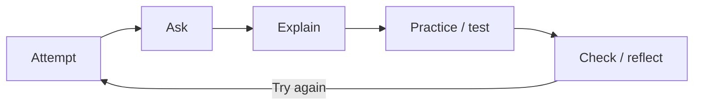

# 🌱 4. Learning With AI: Use a Coach

## Core idea

Use AI to become more capable, not to avoid thinking. If someone else lifts every weight at the gym, you do not get stronger. The same can happen when AI completes every step of a task you want to understand.

## Productive learning loop

**Attempt → Ask → Explain → Test → Reflect**

1. Attempt the problem or explanation yourself, even if your attempt is rough.
2. Ask for a hint, question, example, or next step before asking for the answer.
3. Explain the idea in your own words.
4. Test yourself with a new problem, recall question, or a prompt that asks you to explain the idea out loud.
5. Reflect on what you understand and what still needs work.

## Useful requests

- "Give me one hint, not the solution."
- "Ask me questions that help me find the mistake."
- "Explain this at my level, then ask me to explain it back."
- "Create three new problems that test the same concept."
- "What question would test whether I really understand this?"

## Avoid

Do not skip the first attempt, copy an explanation you cannot explain, or treat a confident answer as proof that you understand.

> [!IMPORTANT]
> **Remember:** Use AI to get better at the work, not only faster at finishing it.

## 📎 Activities

Try the [activities](activities/README.md) hub to practice learning with AI.

## 📎 Examples

Visit the [examples](examples/README.md) hub to see the learning loop in action.

## 💬 Share feedback

Help improve this guide by [sharing feedback](https://docs.google.com/forms/d/e/1FAIpQLSer6w236SEhMt18CPA8vo5dsLnYd5WV6G5jy1irgFv9Osq_lg/viewform?usp=sharing&ouid=111326601163922216667).

<nav class="page-navigation" aria-label="Page navigation">
<a href="#/README.md">⬅ Back to overview</a>

<a class="previous-page" href="#/03-prompting-and-context/README.md">⬅ Previous: Prompting & Context</a><a class="next-page" href="#/05-research-and-verification/README.md">Next: Research & Verification ➡</a>
</nav>
