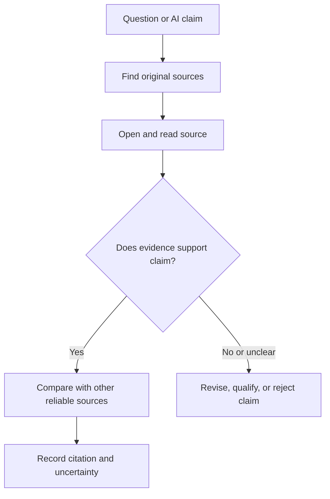

# 🔍 5. Research & Verification: Follow the Evidence

> [!NOTE]
> **Students:** If you use this guide for schoolwork, check your course's citation and AI-use rules before relying on AI for research. Cite only sources you have opened and read.

## Core idea

AI can suggest search terms, questions, and possible sources. Treat those as leads, not conclusions. Use evidence and your own checking to decide what to trust.

## A responsible research workflow

1. Start with your research question and what you already know.
2. Ask AI for keywords, possible subquestions, competing perspectives, and places to look.
3. Open the original sources yourself.
4. Check who created the source, when, why, and what evidence it uses.
5. Compare important claims across reliable sources.
6. Record citations and separate evidence from interpretation.

## Verification checklist

Check these before citing a source:

1. Does the source exist, and can I open it?
2. Does it actually contain the information?
3. Does that information support this specific claim?
4. Is it suitable for the question or decision at hand?

- Did I open the source, or only see it mentioned by AI?
- Could the wording, context, or citation be misleading?
- What uncertainty remains?

## Important rule

> [!WARNING]
> AI sometimes invents facts, quotes, and references. A confident tone does not make a claim true. AI can suggest where to look. It cannot replace reading and validating important sources. For medical, legal, financial, or other consequential decisions, use qualified people and authoritative sources.

> [!IMPORTANT]
> **Remember:** AI can give you clues. Evidence determines what you trust.

## 📎 Activities

Try the [activities](activities/README.md) hub to practice checking claims against evidence.

## 📎 Examples

See the [examples](examples/README.md) hub for what verification looks like across different fields.

## 💬 Share feedback

Help improve this guide by [sharing feedback](https://docs.google.com/forms/d/e/1FAIpQLSer6w236SEhMt18CPA8vo5dsLnYd5WV6G5jy1irgFv9Osq_lg/viewform?usp=sharing&ouid=111326601163922216667).

<nav class="page-navigation" aria-label="Page navigation">
<a href="#/README.md">⬅ Back to overview</a>

<a class="previous-page" href="#/04-learning-with-ai/README.md">⬅ Previous: Learning With AI</a><a class="next-page" href="#/06-brainstorming-and-curiosity/README.md">Next: Brainstorming & Curiosity ➡</a>
</nav>
