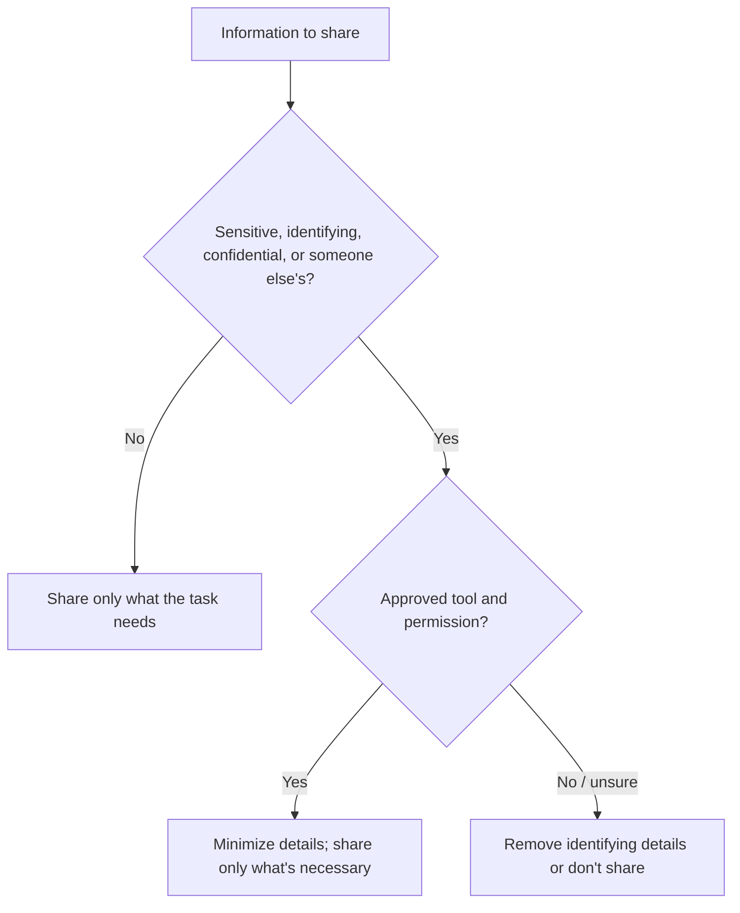

# 🔐 7. Ethics, Privacy & Security: Protect Privacy and Work Fairly

> [!NOTE]
> **Students:** If you use this guide for schoolwork, check your course and assignment rules before using AI. Only share class or personal information with a tool when you have permission to do so.

## Core idea

Responsibility stays with the person using the tool. Protect sensitive information and increase scrutiny when your work affects other people.

## Topics this section covers

- Sensitive and personal data
- Rules for school, work, and disclosure
- Bias and unequal impact
- Consent and representation
- Copyright and provenance
- High-stakes decisions
- Accuracy, accountability, and human review
- Security of third-party tools and extensions

## Before sharing information

Ask whether the data is private, identifying, confidential, regulated, proprietary, or someone else's to control. Remove passwords, account details, personal records, health information, and confidential school or workplace data unless you have a suitable, approved way to handle them. When in doubt, remove identifying details or do not share it. The privacy terms and controls can differ by service and account.

## Before relying on an output

Ask who could be harmed by an error, whether the result can be checked, whether a person affected has recourse, and whether a human must make the final decision.

Watch for bias and missing perspectives, especially when a response concerns people. Having access to a person's writing, image, or voice does not automatically grant permission to reuse it. Check ownership, consent, and attribution before publishing AI-assisted work.

## Rules for school and work

Check the rules that apply before using AI on schoolwork or a work task. They may allow brainstorming or feedback while requiring you to do the final work yourself. When the rules are unclear, ask the person who set them.

For consequential tasks, keep a human review step. You remain responsible for what you submit, send, or publish.

## Third-party tool warning

> [!WARNING]
> Treat MCP servers and skills like software. They may contain malware, malicious instructions, or requests for more access than they need. Use trusted sources, review permissions and code when possible, use least privilege, and never give unknown tools credentials or sensitive data.

> [!IMPORTANT]
> **Remember:** More capability calls for more careful judgment.

## 📎 Activities

Try the [activities](activities/README.md) hub to practice protecting privacy and considering others.

## 📎 Examples

See the [examples](examples/README.md) hub for decisions about academic integrity and company data.

## 💬 Share feedback

Help improve this guide by [sharing feedback](https://docs.google.com/forms/d/e/1FAIpQLSer6w236SEhMt18CPA8vo5dsLnYd5WV6G5jy1irgFv9Osq_lg/viewform?usp=sharing&ouid=111326601163922216667).

<nav class="page-navigation" aria-label="Page navigation">
<a href="#/README.md">⬅ Back to overview</a>

<a class="previous-page" href="#/06-brainstorming-and-curiosity/README.md">⬅ Previous: Brainstorming & Curiosity</a><a class="next-page" href="#/08-ai-automation/README.md">Next: AI Automation ➡</a>
</nav>
