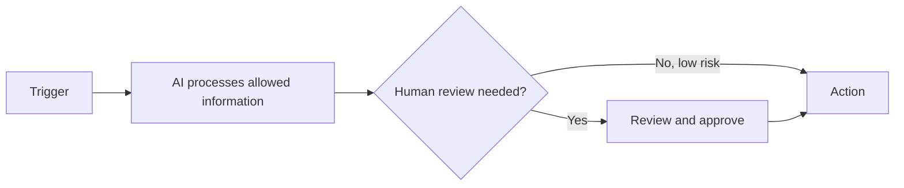

# ⚙️ 8. AI Automation

## Core idea

Automation means setting up a task to run again later, on a schedule, or when something happens. You describe what should happen and when; an AI assistant may be able to carry it out using the information and tools you allow. Programming is one way to automate, but some assistants let you set up recurring work with instructions in everyday language.

## Workflow

1. Choose a task that needs to happen again, such as a weekly summary or a reminder when new information arrives.
2. Specify when it should run, what information it should use, and what result you want.
3. Decide what it may do on its own and what should wait for your review. Set a rule for missing or unclear information.
4. Try it once and check whether the result is right and the instructions are clear.
5. Schedule it or connect a supported trigger. Review its results now and then, and pause it if the task or permissions change.

An automated task is like giving someone a standing instruction: “Every Friday, prepare this update from these notes, and ask me before sending it.” The schedule tells it when to start; the instructions say what to do. You still need to check that it used the right information and followed the approval step.

### Example: prepare a weekly team update

Suppose you want a short update every Friday from project notes in a folder. Set the task to run on Friday, specify which notes to use and what sections the update should include, and ask it to flag missing dates or unclear progress. Have it prepare a draft for you to review rather than send it automatically. Check the first update before relying on future runs.

## AI assistants can run recurring work

You may be able to ask an assistant to do a task once, repeat it on a schedule, or respond to a supported event. For example, [ChatGPT scheduled tasks](https://help.openai.com/en/articles/10291617-scheduled-tasks-in-chatgpt) can run one-time or recurring tasks and monitor for some changes; [Gemini scheduled actions](https://support.google.com/gemini/answer/16316416) can prepare recurring updates; and some [Claude Cowork](https://www.anthropic.com/news/claude-for-teachers) experiences support scheduled work across files and connected tools. These features vary by product, account, and settings, so check what is available before designing around it.

Start with an output you can review, such as a draft, summary, or reminder. Be specific about its sources, schedule, and what it should do when information is missing or uncertain. Review what it can access and whether it can take actions such as sending messages or changing files. Keep approval points for consequential actions, and pause or remove a task when you no longer need it.

## Human review belongs where

Accuracy, safety, privacy, fairness, quality, consent, money, reputation, or other people's opportunities are affected.

## Ownership test

You should understand the result well enough to inspect it, question it, improve it, explain it, and take responsibility for using it.

> [!IMPORTANT]
> **Remember:** Automate repetition. Keep judgment.

## 📎 Activities

Try the [activities](activities/README.md) hub to practice designing a reviewed workflow.

## 📎 Examples

Visit the [examples](examples/README.md) hub for a weekly market briefing workflow.

## 💬 Share feedback

Help improve this guide by [sharing feedback](https://docs.google.com/forms/d/e/1FAIpQLSer6w236SEhMt18CPA8vo5dsLnYd5WV6G5jy1irgFv9Osq_lg/viewform?usp=sharing&ouid=111326601163922216667).

<nav class="page-navigation" aria-label="Page navigation">
<a href="#/README.md">⬅ Back to overview</a>

<a class="previous-page" href="#/07-ethics-privacy-security/README.md">⬅ Previous: Ethics, Privacy & Security</a><a class="next-page" href="#/09-coding-with-agents/README.md">Next: Coding With Agents ➡</a>
</nav>
