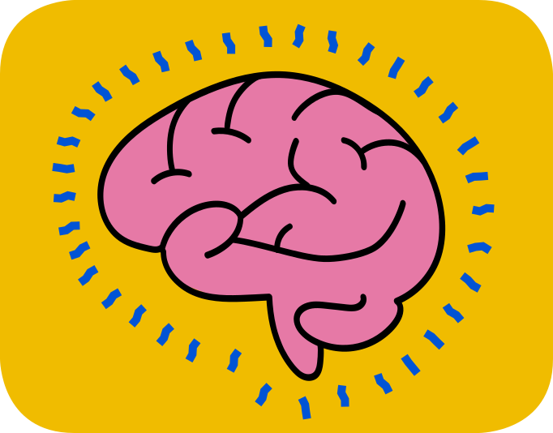

# 🧭 Curious AInough: Elevate Your Thinking

*A practical guide to learning, creating, and making decisions with AI—at work, at school, or on your own.*

Artificial intelligence is here to stay, whether we like it or not. That's a reason to act. With all the uncertainty life brings, the best thing you can do is elevate your thinking, not give it away. It is something no one can ever take away from you. If you're curious AInough, begin with [AI and Large Language Models](01-ai-and-llms/README.md), then [Start Here](02-start-here/README.md).

## 🔁 The five-step loop

**Define the goal → Give context → Explore → Check → Decide**

## 📖 Table of contents

| # | Section | What it covers |
| --- | --- | --- |
| 1 | [🧠 AI and Large Language Models](01-ai-and-llms/README.md) | What people usually mean by AI, and what an LLM is |
| 2 | [🧭 Start Here: Stay in the Driver's Seat](02-start-here/README.md) | The mindset, the five-step loop, a one-page cheat sheet |
| 3 | [🗣️ Prompting & Context](03-prompting-and-context/README.md) | How to ask for what you actually need |
| 4 | [🌱 Learning With AI](04-learning-with-ai/README.md) | Using AI as a coach instead of an answer machine |
| 5 | [🔍 Research & Verification](05-research-and-verification/README.md) | Following evidence, not confident-sounding claims |
| 6 | [💡 Brainstorming & Curiosity](06-brainstorming-and-curiosity/README.md) | Developing and stress-testing your own ideas |
| 7 | [🔐 Ethics, Privacy & Security](07-ethics-privacy-security/README.md) | Protecting data and working fairly |
| 8 | [⚙️ Creating & Automation](08-creating-and-automation/README.md) | Turning repetitive work into a reviewed process |
| 9 | [🤖 Coding With Agents](09-coding-with-agents/README.md) | Working safely with AI coding agents |
| 10 | [🧠 Large Language Models](10-large-language-models/README.md) | How LLMs, tools, MCP, and agents work together |
| 11 | [🧰 Tool Directory](11-tool-directory/README.md) | Choosing tools, comparing access, and checking terms |

## 🧩 Learn by trying

Many sections include worked [examples](02-start-here/examples/README.md) and hands-on [activities](02-start-here/activities/README.md). Open a section to find its examples and activity hubs, then use them to see the ideas in practice and try them yourself.

## 🤝 How to contribute

Want to add an example or a new topic? See [🤝 How to contribute](CONTRIBUTING.md).

## 💬 Share feedback

Help improve this guide by [sharing feedback](https://docs.google.com/forms/d/e/1FAIpQLSer6w236SEhMt18CPA8vo5dsLnYd5WV6G5jy1irgFv9Osq_lg/viewform?usp=sharing&ouid=111326601163922216667).

## 🔗 Further reading

- [🔗 Official Resources & Further Reading](official-resources.md): outside links on how AI works, practical learning, and tool documentation.

## 📄 License

This guide is licensed under [CC BY 4.0](https://github.com/Alex-cmd-dev/Curious-AInough/blob/main/LICENSE): you may share and adapt it, with credit to Curious AInough contributors and a link to the license.

Among the existing examples, only three are covered: learn photosynthesis with AI, the weekly market briefing, and the weekly campus events digest. The rest are not covered yet, because their authors haven't agreed to a license: the examples in sections 1 and 2, the probability density and rocket thrust examples, the research examples, the study group and study-room app example, and the academic integrity and company privacy example. See the [license file](https://github.com/Alex-cmd-dev/Curious-AInough/blob/main/LICENSE) for the exact list.
